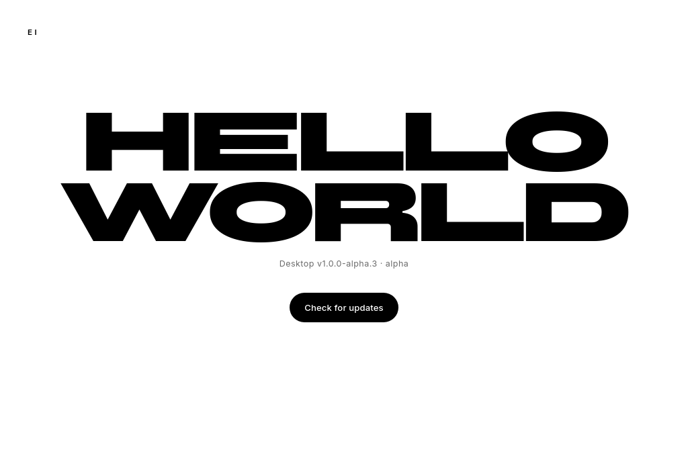

# EI ERP — releases

[](https://github.com/iamMD01/ei-erp-releases/releases)
[](https://github.com/iamMD01/ei-erp-releases/releases/download/channel-alpha/latest.json)
[](https://github.com/iamMD01/ei-erp-releases/releases)
[](https://github.com/iamMD01/ei-erp-releases/releases)

Signed Linux and Windows desktop releases for **EI ERP**, a secure college ERP.

> Source code is private. This repository contains **only signed release artifacts and update manifests**.



## Download

- **Linux (Debian / Ubuntu):** `EI-ERP_<version>_amd64.deb`
- **Windows:** `EI-ERP_<version>_x64-setup.exe`

Open the [releases page](https://github.com/iamMD01/ei-erp-releases/releases) to download.

## Install (Debian / Ubuntu)

```bash
sudo apt install ./EI-ERP_<version>_amd64.deb
```

## Install (Windows)

1. Download `EI-ERP_<version>_x64-setup.exe`.
2. Run it. Alpha/beta builds are unsigned, so SmartScreen may warn:
   **More info → Run anyway**.

## Auto-update

EI ERP checks the update manifest for its baked-in channel.

| Channel | Audience | Manifest |
|---|---|---|
| `alpha` | builder / owner | [channel-alpha/latest.json](https://github.com/iamMD01/ei-erp-releases/releases/download/channel-alpha/latest.json) |
| `beta` | pilot staff | created at the first beta release |
| `stable` | whole college | created at the first stable release |

How an update runs:

1. The app fetches its channel manifest.
2. It downloads the new signed installer for its platform.
3. It verifies the `.sig` with the embedded updater public key.
4. Linux installs the `.deb` through the package manager; Windows runs the NSIS installer.

## Verify

Each release includes a `.sig` file (minisign signature). The app verifies the
signature automatically before installing an update. Do not install an artifact
without its `.sig`.

## Channels

- **alpha** — frequent prereleases; may break.
- **beta** — pilot staff; feature-complete but still testing.
- **stable** — production.

## Security

- Only signed artifacts are published here.
- The source code stays private.
- The updater private key is never in this repository or in the app.
- Windows alpha/beta installers are not Authenticode-signed; SmartScreen warns.

## Packages

- **Linux:** `.deb`. AppImage is deferred until the AppImageLauncher/bundler issues are resolved.
- **Windows:** NSIS `.exe`. MSI is not built because WiX requires a Windows runner.

## About EI ERP

Desktop-first, role-based college ERP for one university. Built with Tauri v2,
TypeScript, Rust, and Supabase.
